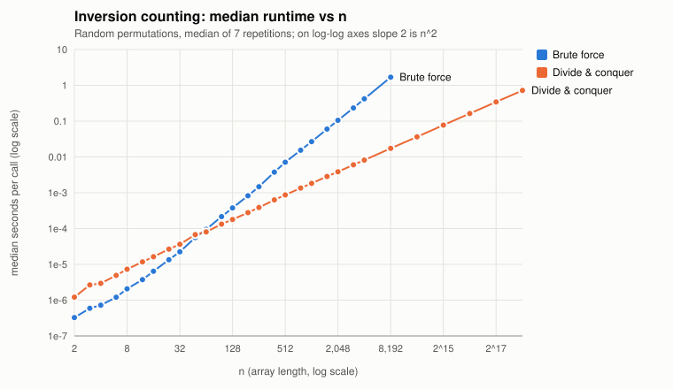
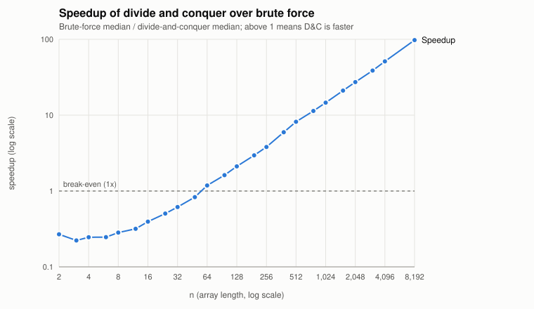
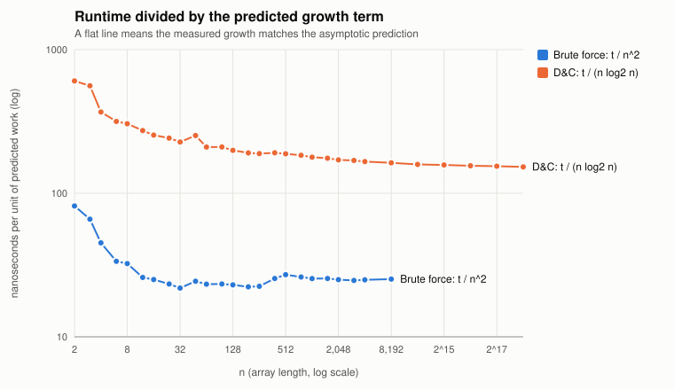

# Part I: Divide and Conquer — Counting Inversions

An inversion in `A[0..n-1]` is a pair of indices `i < j` with `A[i] > A[j]`.
This part implements a brute-force counter and a divide-and-conquer
sort-and-count, uses the brute force as an oracle to validate the faster
method, and benchmarks both.

## Files

| Path | Contents |
| --- | --- |
| [`1a/inversions.py`](1a/inversions.py) | `brute_force_count`, `merge_and_count`, `sort_and_count`, plus an instrumented comparison-counting copy used only for reporting |
| [`1b/validate.py`](1b/validate.py) | 15 hand-checkable arrays + 300 random distinct arrays + 50 random arrays with duplicates |
| [`1b/benchmark.py`](1b/benchmark.py) | Repeated, median-based timing on increasing `n` |
| [`1b/plot.py`](1b/plot.py) | Draws the SVG graphs from the benchmark CSV (standard library only) |
| [`main.py`](main.py) | Runs validation, benchmark, then plots |
| `1b/validation_results.csv` | One row per validation array: both counts, sorted-output check, pass/fail |
| `1b/benchmark_results.csv` | One row per (algorithm, n): median/min/max seconds, comparison count, normalized time |
| `1b/benchmark_raw.csv` | Every individual timing repetition |
| `1b/runtime_loglog.svg`, `1b/speedup.svg`, `1b/normalized.svg` | Graphs |

## How to Run

Python 3.10 or newer; no third-party packages. Results below were produced with
**Python 3.14.3 on an Apple M3 (macOS, arm64)**. From the `A2/part-1` folder:

```sh
python3 main.py              # validation + benchmark (~1 minute) + plots
python3 main.py --validate   # validation only (a few seconds)
python3 1a/inversions.py     # tiny demo on [2, 4, 1, 3, 5]
```

Each script in `1b/` can also be run on its own (`python3 1b/validate.py`,
`python3 1b/benchmark.py`, `python3 1b/plot.py`). Seeds: validation uses
`4050`, the benchmark uses `2026`. All output files are written into `1b/` and
overwritten on rerun. Timings will differ on other machines; counts and
validation results will not.

---

## Part 1A. The Two Algorithms

### A. Brute-force pair counting

```python
for i in range(n - 1):
    for j in range(i + 1, n):
        if arr[i] > arr[j]:
            count += 1
```

**Runtime of this implementation.** The inner loop runs `n-1-i` times for each
`i`, so the comparison executes exactly

  Σ_{i=0}^{n-2} (n-1-i) = (n-1) + (n-2) + … + 1 = n(n-1)/2

times. There is no early exit, so this count is the same for sorted, reversed,
and random inputs; only the number of `count += 1` executions changes (0 to
n(n-1)/2), and that is bounded by the number of comparisons. Each iteration
does constant work, so the running time is **Θ(n²)** in the best, average, and
worst case, with Θ(1) extra space. The benchmark confirms this: doubling `n`
from 1024→2048→4096→8192 multiplied the median time by 3.93, 3.99, and 4.04
(ideal: 4), and `time / n²` levels off at about 25 ns, which is about 50 ns
per compared pair, since there are n²/2 pairs.

### B. Divide-and-conquer sort-and-count

`sort_and_count(A)` returns `(inversion_count, sorted_list)`:

1. If `n ≤ 1`, return `(0, A)`.
2. Split at `mid = n // 2` into `L = A[:mid]`, `R = A[mid:]`.
3. Recursively get `(c_L, L_sorted)` and `(c_R, R_sorted)`.
4. `merge_and_count(L_sorted, R_sorted)` merges and returns `(c_X, merged)`.
5. Return `(c_L + c_R + c_X, merged)`.

The central step in the merge (from [`1a/inversions.py`](1a/inversions.py)):

```python
if left[i] <= right[j]:
    merged.append(left[i]); i += 1
else:
    # right[j] < left[i] <= left[i+1] <= ... <= left[-1]
    cross += len_left - i
    merged.append(right[j]); j += 1
```

When the next right element is smaller than the next left element, it is also
smaller than *every remaining* left element because the left half is sorted, so
it forms `len(left) - i` inversions at once. Those pairs are counted with one
subtraction instead of being examined one by one.

### Correctness

**Every inversion falls into exactly one of three classes.** For an inversion
`(i, j)` with `i < j` and the split point `mid`:

- **Left inversion:** both `i, j < mid` (both in `L`).
- **Right inversion:** both `i, j ≥ mid` (both in `R`).
- **Cross inversion:** `i < mid ≤ j` (one in each half).

The classes are disjoint and cover every pair, so
`total = c_L + c_R + c_X` provided each term is right.

**Left and right inversions** are counted by the recursive calls (by strong
induction on `n`; the base case `n ≤ 1` has no pairs, so 0 is correct). The
recursive call on `L` sees exactly the pairs inside `L` with their original
relative order, so it counts each left inversion once and nothing else.

**Cross inversions** are counted by the merge. A cross inversion is just a pair
`(x, y)` with `x ∈ L`, `y ∈ R`, `x > y`; positions inside each half do not
matter, because every element of `L` precedes every element of `R` in the
original array. So sorting each half first does not change the cross count.
Claim: the merge adds 1 for each such pair exactly once.

- Fix `y ∈ R`. At the moment `y` is appended, let `i` be the current left index.
  The elements `left[0..i-1]` were appended earlier, which only happens when
  `left[i'] ≤` the current right element, which was `≤ y`; so none of them is
  greater than `y`. The merge reaches the `else` branch for `y` only because
  `left[i] > y`, and the left half is sorted, so every one of
  `left[i..end]` is `> y`. Therefore `len(left) - i` is exactly the number of
  `x ∈ L` with `x > y`.
- If `L` runs out before `y` is placed, `y` is appended in the tail
  `merged.extend(right[j:])` and adds 0; that is correct because every `x ∈ L`
  was placed earlier, meaning `x ≤` some right element `≤ y`.
- Each `y` is appended exactly once, so each cross pair is counted once, when
  its right element is placed, and never again. Left elements never add to the
  count, so nothing is double-counted.

Ties (`left[i] == right[j]`) take the left element, so equal values are never
counted. That matches the strict `A[i] > A[j]` definition, and the duplicate
validation cases check it.

**Sorted output.** The merge is the standard mergesort merge, so by the same
induction it returns `sorted(A)`.

### Complexity

- **Brute force:** exactly n(n-1)/2 comparisons → **Θ(n²)** time, Θ(1) extra space.
- **Divide and conquer:** splitting by slicing costs Θ(n), and the merge does at
  most `n - 1` comparisons and `n` appends, Θ(n). So

  T(n) = T(⌊n/2⌋) + T(⌈n/2⌉) + Θ(n),  T(1) = Θ(1).

  The recursion tree has ⌈log₂ n⌉ levels, and the subproblems on each level
  partition the `n` elements, so each level costs Θ(n). By the Master Theorem
  (a = 2, b = 2, f(n) = Θ(n) = Θ(n^{log₂2}), case 2), **T(n) = Θ(n log n)**.
  This holds for every input order because the split and merge work does not
  depend on the values. Extra space is Θ(n) for the slices and merged lists
  alive at once (n + n/2 + n/4 + … ≤ 2n along one root-to-leaf path), plus
  Θ(log n) recursion depth.

  Measured comparisons match: the instrumented copy reports 8,948 merge
  comparisons at n = 1,024 (0.87·n log₂ n) and 4,387,631 at n = 262,144
  (0.93·n log₂ n), always below the n log₂ n upper bound.

---

## Part 1B. Validation and Runtime Scaling

### Validation design

The brute-force counter is the oracle: it follows the definition literally, so
it is easy to check by inspection, and it was also checked against hand counts.
Each validation array must satisfy all of:

1. `brute_force_count(A) == sort_and_count(A)[0]` (exact agreement),
2. the returned list equals `sorted(A)`,
3. neither function modified `A`,
4. for hand cases, both equal the inversion count worked out by hand. The
   inverted pairs are listed in the CSV's `hand_pairs` column.

| Group | Count | Contents |
| --- | --- | --- |
| Hand-checkable | 15 | empty, single, 2-element sorted/reversed, already sorted, reverse sorted (n = 4, 5), nearly sorted (one swap, two swaps, one element moved), largest-first, textbook `[2,4,1,3,5]`, random orders, negative values |
| Random distinct | 300 | `n` uniform in 0–60, distinct values drawn from −1000…999, seed 4050 |
| Random with duplicates | 50 | `n` in 0–60, values 0–9; extra check of the strict `>` / tie handling |

**Result: 365 / 365 passed.** The benchmark also checks the brute force against
divide and conquer on its own random permutations up to n = 2,048.

To confirm that the suite can find bugs, two deliberately broken merges were
run through it. Replacing `cross += len_left - i` with `cross += 1` failed 330
cases. Changing the tie rule `<=` to `<` failed 45 cases, all of them in the
duplicate group. The distinct-value cases cannot see that bug, which is why the
duplicate group is included. Passing these tests shows that the implementations
agree on the tested inputs. The proof above is the argument that they work on
all inputs.

### Timing methodology

- Inputs are seeded random permutations of `0..n-1`, all generated before timing
  starts. At each `n`, both algorithms receive the same list.
- Only the counter call is timed (`timeit`, garbage collector disabled).
  Input generation, comparison counting, CSV output, and plotting all happen
  outside the timed region. Plotting is a separate script.
- For each (algorithm, n), the loop count is calibrated so that one repetition
  lasts at least 20 ms. Tiny inputs are called up to 100,000 times per
  repetition, so timer resolution does not matter.
- Each measurement is repeated 7 times. The **median** per-call time is reported,
  and min/max are kept. Spread was small: at n = 8,192 brute force ranged from
  1.684 to 1.705 s.
- Sizes: 2 to 4,096 for both algorithms with fine steps (×1.5 and ×2) near the
  crossover, brute force up to 8,192 (≈1.7 s per call), and divide and conquer
  up to 262,144.

### Results

Median seconds per call ([`1b/benchmark_results.csv`](1b/benchmark_results.csv)):

| n | brute force | divide & conquer | speedup (BF / D&C) |
| ---: | ---: | ---: | ---: |
| 2 | 3.26e-7 | 1.21e-6 | 0.27× |
| 16 | 6.41e-6 | 1.63e-5 | 0.39× |
| 32 | 2.24e-5 | 3.64e-5 | 0.61× |
| 48 | 5.61e-5 | 6.76e-5 | 0.83× |
| **64** | **9.53e-5** | **8.05e-5** | **1.18×** |
| 128 | 3.77e-4 | 1.78e-4 | 2.11× |
| 512 | 7.10e-3 | 8.68e-4 | 8.19× |
| 1,024 | 2.67e-2 | 1.83e-3 | 14.6× |
| 4,096 | 4.19e-1 | 8.17e-3 | 51.2× |
| 8,192 | 1.69 | 1.73e-2 | 97.6× |
| 262,144 | — | 0.720 | — |







### Interpretation

**Growth rates match the analysis.** On the log-log plot the brute-force line
has slope ≈ 2 and the divide-and-conquer line has slope just over 1. Doubling `n` multiplies
brute-force time by ≈ 4.0 (3.93, 3.99, 4.04 for 1024→8192), as Θ(n²) predicts,
and multiplies divide-and-conquer time by 2.09–2.12 from 4,096 up to 262,144.
That is Θ(n log n): 2·log(2n)/log n is 2.17 at n = 4,096 and 2.11 at n = 131,072.
In the normalized graph, `t / n²` for brute force is flat at about 25 ns once
n ≥ 64, and `t / (n log₂ n)` for divide and conquer slowly decreases toward
about 150 ns. Both curves level off rather than growing, which is what a correct
growth term looks like. The extra height at small `n` is fixed per-call
overhead that has not yet been spread over enough work. The speedup keeps growing
roughly like n / log n, from 1.18× at n = 64 to 97.6× at n = 8,192.

**Crossover.** On this machine, divide and conquer becomes faster **between
n = 48 and n = 64**. It is still 0.83× as fast at n = 48, it is 1.18× faster at
n = 64, and it stays faster at every larger tested size. Below that, brute force
wins by up to about 4× (at n ≤ 8).

**Why the crossover depends on implementation and hardware.** Asymptotic
notation drops constant factors, but the crossover is set entirely by them.
Write the times as c_BF·n² and c_DC·n log₂ n. The crossover is where they are
equal, `n / log₂ n = c_DC / c_BF`. Near the crossover we measured
c_BF ≈ 23 ns and c_DC ≈ 210 ns (the `ns_per_n2` and `ns_per_nlog2n` columns at
n = 64), a ratio of about 9. `n / log₂ n = 9` gives n ≈ 50, which is consistent
with the measured 48–64 range. Anything that
changes those constants moves the crossover:

- *Implementation:* in CPython, each recursive call, list slice, and
  `append` is an interpreted operation that allocates memory. The brute-force
  inner loop is a simple compare-and-increment. A version that merges into one
  preallocated buffer, or that switches to insertion-sort or brute-force
  counting below a cutoff (as production mergesorts do), would lower
  c_DC and move the crossover down.
- *Language/runtime:* in compiled C/C++ or Rust, both constants shrink, but
  the brute force's tight loop benefits most (registers, branch prediction,
  vectorization), so the crossover typically moves to a different `n`. The
  interpreter version (3.14 vs older) also changes both constants.
- *Hardware:* cache size, memory bandwidth, branch predictor quality, and clock
  speed affect the two algorithms differently. Brute force rereads one small
  array. Divide and conquer allocates many short-lived lists. Thermal
  throttling and background load add noise, which is why we report medians.

For this reason the result is reported as "between 48 and 64 on this machine"
rather than as a property of the algorithms. The asymptotic result does not
depend on the machine: for large enough `n`, Θ(n log n) beats Θ(n²) on any of
them, and the measured gap reaches about 100× by n = 8,192.
